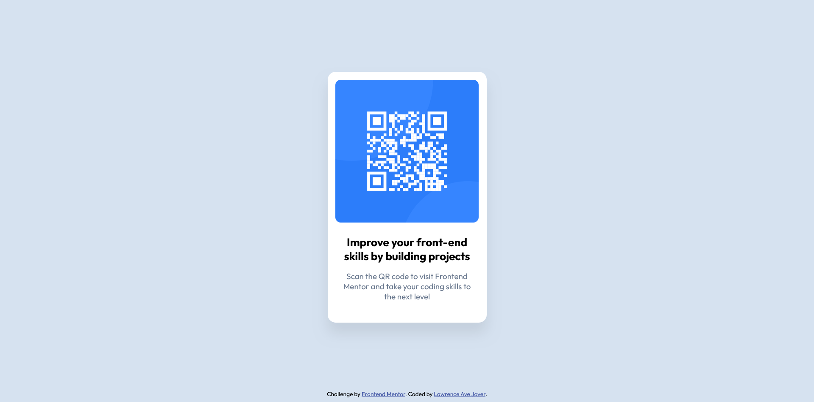

# Frontend Mentor - QR code component solution

This is a solution to the [QR code component challenge on Frontend Mentor](https://www.frontendmentor.io/challenges/qr-code-component-iux_sIO_H). Frontend Mentor challenges help you improve your coding skills by building realistic projects. 

## Table of contents

- [Overview](#overview)
  - [Screenshot](#screenshot)
  - [Links](#links)
- [My process](#my-process)
  - [Built with](#built-with)
  - [What I learned](#what-i-learned)
  - [Continued development](#continued-development)
  - [AI Collaboration](#ai-collaboration)
- [Author](#author)


## Overview

I'm working on my first project from Frontend Mentor, the QR Code Component coding challenge.

### Screenshot





### Links

- Solution URL: [Add solution URL here](https://your-solution-url.com)
- Live Site URL: [Add live site URL here](https://your-live-site-url.com)

## My process

First, I tried to get everything right in the HTM before setting up th CSS. I also tried to follow the semantic HTML practices I know, such as using <article> instead of using <div> for the card.

After that, I worked on centering the card using CSS. Most of my focus has been on figuring out how to center everything properly.


### Built with

- Semantic HTML5 markup
- CSS custom properties
- Flexbox

### What I learned

```html
In HTML. I learned about semantic HTML and the difference between elements like <article> and <div>. I learned to think about the purpose of the content I'm putting on the page so I can choose the most appropriate HTML element or container.

```
```css

In CSS, I mostly learned about Flexbox and how to use its properties to center elements on a page. For example, I learned how display: flex, justify-content: center, align-items: center, and min-height: 100vh work together to center an element both horizontally and vertically.


```

If you want more help with writing markdown, we'd recommend checking out [The Markdown Guide](https://www.markdownguide.org/) to learn more.


### Continued development

I want to continue focusing on how to use Flexbox properly and how to get the layout right. I want to understand how to position and align elements correctly so I can create clean, well-structured layouts in my future projects.


### AI Collaboration

Describe how you used AI tools (if any) during this project. This helps demonstrate your ability to work effectively with AI assistants.

- What tools did you use (e.g., ChatGPT, Claude, GitHub Copilot)? the buily in copilot with my vs code.
- How did you use them (e.g., debugging, generating boilerplate, brainstorming solutions)? I used them for debugging and brainstorming solutions.
- What worked well? What didn't? AI worked well for me when I needed recommendations on where to start, ideas on how to approach a project, or guidance on how to turn my ideas into reality. Honestly, I don't think there was any part of this project where using AI didn't go well for me.


## Author

- Website - [Add your name here](https://www.your-site.com)
- Frontend Mentor - [@yourusername](https://www.frontendmentor.io/profile/yourusername)
- Twitter - [@yourusername](https://www.twitter.com/yourusername)

**Note: Delete this note and add/remove/edit lines above based on what links you'd like to share.**
